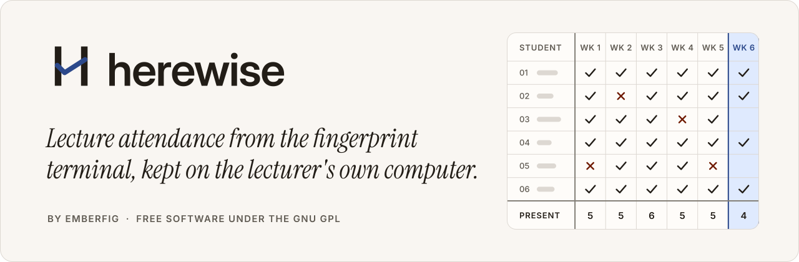
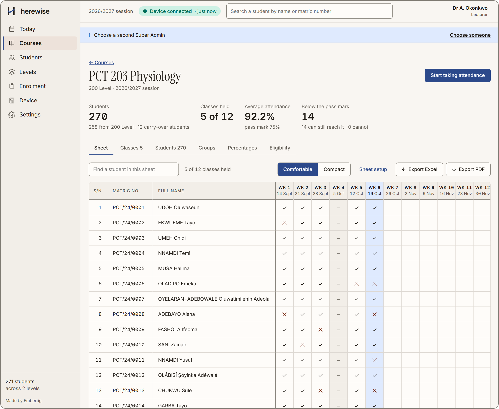
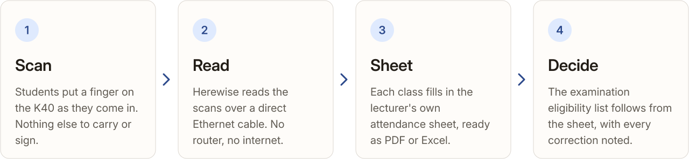

<a href="https://github.com/emberfig/herewise/releases/latest">
  <picture>
    <source media="(prefers-color-scheme: dark)" srcset="design/readme/cover-dark.svg">
    
  </picture>
</a>

<p align="center">
  <picture>
    <source media="(prefers-color-scheme: dark)" srcset="design/readme/facts-dark.svg">
    
  </picture>
</p>

<p align="center">
  <a href="https://github.com/emberfig/herewise/releases/latest"><picture>
    <source media="(prefers-color-scheme: dark)" srcset="design/readme/download-dark.svg">
    
  </picture></a>
  &nbsp;
  <a href="https://github.com/emberfig/herewise/releases"><picture>
    <source media="(prefers-color-scheme: dark)" srcset="design/readme/releases-dark.svg">
    
  </picture></a>
</p>

<p align="center">
  <a href="#what-it-does">What it does</a> ·
  <a href="#install">Install</a> ·
  <a href="#build-from-source">Build from source</a> ·
  <a href="CHANGELOG.md">Changelog</a> ·
  <a href="#licence">Licence</a>
</p>

An offline Windows program for taking lecture attendance with a ZKTeco K40 fingerprint terminal,
written to replace ZKBio Time.Net. It keeps a register for each course, carry-over students
included, fills in the lecturer's own attendance sheet from the scans, and produces the examination
eligibility list. It runs on the lecturer's own computer, talks to the terminal over an Ethernet
cable, and needs no internet and no account with anyone.

Made by [Emberfig](https://emberfig.com). In use in one university department since September 2026.

<p align="center">
  <picture>
    <source media="(prefers-color-scheme: dark)" srcset="design/readme/screenshot-sheet-dark.png">
    
  </picture>
  <br>
  <sub>The attendance sheet of a made-up course. Ticks are scans, crosses are absences, and the shaded
  week had no class, so it counts for nobody.</sub>
</p>

## How it works

<picture>
  <source media="(prefers-color-scheme: dark)" srcset="design/readme/how-it-works-dark.svg">
  
</picture>

## What it does

- **A register for every course**, home and carry-over students together, with a course's
  practicals split into groups when the department runs them that way.
- **The lecturer's own sheet**, filled in from the scans, on screen and as PDF or Excel in the same
  layout, so what is checked is what is signed.
- **The eligibility list** against the pass mark, with who can still reach it and who cannot.
- **Corrections that keep the evidence.** A scan is never edited. A correction is a mark with a note,
  and every change is in the activity log.
- **Roles.** A course rep can ask for a correction but not apply one; a viewer can only read.
- **Backups** to a file, from Settings.

## What it needs

- Windows 10 or 11, 64-bit. The window uses WebView2, which is part of Windows 11 and most copies of
  Windows 10.
- A ZKTeco K40 on a direct Ethernet cable, no router. Tested on firmware Ver 6.60 Sep 10 2019,
  platform ZLM60_TFT. Herewise sets up the computer's Ethernet for the terminal itself, with one
  Windows prompt. Other ZKTeco models that pyzk supports may work; only the K40 has been tested.
- A laptop without an Ethernet port needs a USB Ethernet adapter.

## Install

Download `Herewise-Setup-<version>.exe` from [Releases](https://github.com/emberfig/herewise/releases)
and check it against `SHA256SUMS.txt`:

```powershell
Get-FileHash .\Herewise-Setup-0.1.19.exe -Algorithm SHA256
```

The installer is per user and needs no administrator rights. It is not yet code signed, so Windows
SmartScreen will warn before it runs; the checksum is how to know the file is the one published
here. What each release changed is in `CHANGELOG.md`.

## Build from source

Python 3.11. Create the virtual environment outside any synced folder (OneDrive, Dropbox): a
database or a venv inside one can be corrupted by the sync.

```bash
pip install -r requirements-dev.txt
python -m pytest -q
python -m rollcall
python packaging/build.py
```

`python -m rollcall` serves the app at `http://127.0.0.1:8000` with its data in `instance/`;
`ROLLCALL_DATA_DIR` moves it. `packaging/build.py` makes the app folder, the installer, the source
archive and the checksums in `dist/`. The Python package is called `rollcall`, the program's name
before it was Herewise.

To look at the screens without a terminal, `python scripts/demo_data.py --reset` fills a scratch
register with made-up students, and `python scripts/dev_server.py 8020 --fake-terminal` serves it.
Every name in the repository's data and tests is made up.

The pictures in this README are drawn by `design/readme_art.py` from the app's own colour tokens and
typefaces, and the logo by `design/logo.py`.

## How the code is kept honest

- Scans, corrections and the audit log are append only, enforced by database triggers. A correction
  never edits a scan; it is a mark with a note.
- `enable_device()` always runs in a `finally`, and only `rollcall/device.py` talks to the terminal.
- Two fingers per student at enrolment. The terminal's capacity (1,000 users) is checked before any
  import or push, never after.
- pyzk comes from GitHub at a pinned commit, not PyPI, whose 0.9 misses later fixes.
- Importing scans from a USB flash drive is designed and not built: it waits on a real file from the
  terminal, because the format is not to be written from documentation.

## Questions and problems

Write to hello@emberfig.com.

## Licence

Copyright (C) 2026 Emberfig.

Herewise is free software: you can redistribute it and/or modify it under the terms of the GNU
General Public License as published by the Free Software Foundation, either version 2 of the
License, or (at your option) any later version. It is distributed in the hope that it will be
useful, but WITHOUT ANY WARRANTY; without even the implied warranty of MERCHANTABILITY or FITNESS
FOR A PARTICULAR PURPOSE. See the GNU General Public License for more details.

The full texts are in `LICENSE` (version 2) and `GPL-3.0.txt` (version 3). Installers are
distributed under version 3, because two parts they bundle are under the Apache License 2.0
(python-multipart, and OpenSSL inside Python's `ssl` module and `cryptography`), which version 3
accepts and version 2 does not. pyzk, which speaks the terminal's protocol, is under the GNU GPL.
The source of every release is published beside its installer. Each bundled package's own licence
travels in the build, under `licences/` and in its `.dist-info` folder. The typefaces in the app and
in these pictures, Inter and Instrument Serif, are under the SIL Open Font License 1.1.
